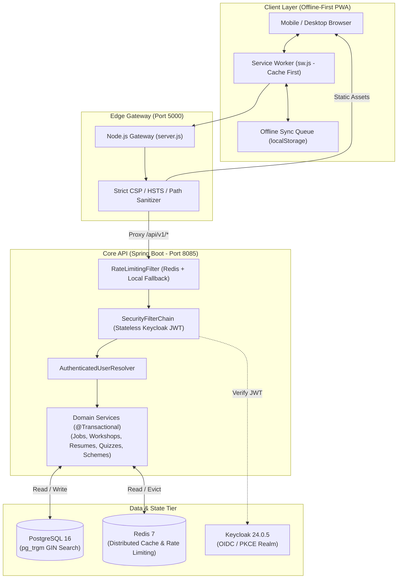

# 🌾 Gramin Career Setu — గ్రామీణ కెరీర్ సేతు
### *Rural Career Advancement & Employment Bridge Platform*

[](https://github.com/yogeshkamisetty/Gramin_Career_Setu)
[](https://openjdk.org/projects/jdk/21/)
[](https://spring.io/projects/spring-boot)
[](https://www.keycloak.org/)
[](https://www.postgresql.org/)
[](https://redis.io/)
[](https://deepmind.google/)

---

## 📖 Overview

**Gramin Career Setu** is an offline-first, bilingual (Telugu & English) career empowerment platform engineered specifically for rural youth in India who face severe information divides, language barriers, and intermittent internet connectivity. The platform bridges the gap between rural talent and economic opportunities by unifying localized job matching, government welfare schemes, scholarship discovery, skill workshops, and an automated ATS resume builder into a single accessible portal.

---

## 🛠️ Tech Stack

| Layer | Technologies & Frameworks | Purpose |
| :--- | :--- | :--- |
| **Frontend & PWA** | Semantic HTML5, CSS3 (Design Tokens, Responsive Grid), Vanilla ES6+ JavaScript | High-speed, zero-dependency client that runs smoothly on low-spec mobile devices. |
| **Bilingual & Voice** | Custom `i18n.js` Translation Engine, Web Speech API | Seamless English ↔ Telugu real-time toggling with voice narration for low-literacy accessibility. |
| **Edge Gateway** | Node.js native HTTP server (`server.js`) | Path-traversal sanitization, reverse-proxying API routes, and strict security headers (CSP, HSTS). |
| **Backend REST API** | Java 21, Spring Boot 3.3.5 (Spring MVC, Data JPA, Security, Actuator, Cache) | Modular monolith architecture organizing domain logic into distinct, transactional boundaries. |
| **Identity & Access** | Keycloak 24.0.5 (OAuth2 / OIDC Resource Server with JWT & PKCE flow) | Secure, standards-compliant authentication supporting Student, Volunteer, and District Admin roles. |
| **Persistence & Cache** | PostgreSQL 16 Alpine, Redis 7 Alpine, Flyway Migration Engine (`V1`–`V5`) | ACID-compliant relational data storage, trigram full-text indexing, query caching, and distributed rate limiting. |
| **DevOps & Containers** | Docker Compose v3.8, Shell/PowerShell DB backup/restore scripts | Containerized orchestration of the database, cache, auth server, and backend services. |

---

## 🏛️ Architecture & Data Flow



---

## 🤖 How Google Antigravity Was Used

Google Antigravity served as an autonomous, end-to-end software engineering partner across the entire development lifecycle:

* **From Static Mockups to Dynamic Full-Stack**:
  * Transformed a collection of disconnected static HTML prototypes into an integrated, interactive platform spanning 21 connected pages.
  * Designed and built the entire Java 21 / Spring Boot backend, configuring Spring Security with Keycloak OAuth2/OIDC, Flyway schema migrations, and JPA repositories from scratch.
* **Bilingual Translation Engineering**:
  * Unified a 168-key Telugu ↔ English dictionary embedded directly in `assets/i18n.js`, eliminating key mismatches and ensuring zero untranslated English leaks across all headings, navigation bars, and modals.
* **Vector Illustration Generation**:
  * Generated 4 custom high-resolution SVG artworks tailored to rural Indian culture: a village sunrise landscape, a celebratory student group, a smartphone OTP verification graphic, and a student working on a laptop against rural hills.
* **Multi-Role Engineering Audit & Remediation**:
  * Conducted an exhaustive audit acting simultaneously as **Principal Architect, Backend Engineer, Security Engineer, QA, DevOps, and Product Reviewer**.
  * Identified 10 concrete vulnerabilities and bottlenecks (including BOLA in workshop cancellation, rate-limiter IP spoofing, full table scans on job search, and cleartext PII logging) and remediated every single issue with a strict **dual-audit verification** process.
* **Automated CI/CD & Deployment**:
  * Automated testing, regression verification, and Git deployment pipelines directly to GitHub.
* **Autonomy Level**: **~90% Agent-Driven**. Architecture design, Java backend development, Spring Security configuration, Flyway migrations, SVG generation, translation dictionary compilation, debugging, and automated testing were performed autonomously by Antigravity, guided by high-level user specifications and design screenshots (~10% manual user steering).

---

## ✨ Key Features

1. **Bilingual Telugu ↔ English Engine with Voice Narration**:
   Allows instant, flicker-free toggling between Telugu and English across all 21 pages. Integrated with the Web Speech API to provide voice narration for rural youth with varying reading proficiencies.
2. **Offline-First Progressive Web App (PWA)**:
   Designed specifically for low-bandwidth and intermittent 2G/3G networks. Precaches a small app shell (about 1.1 MB) and caches everything else the first time it is opened, so a first visit on 2G is not spent downloading pages the student has not asked for.
3. **Role-Based Authentication & Personalized Dashboards**:
   A 4-step sign-up flow (mobile + password, a 6-digit confirmation code, password strength scoring) across three roles (**Student / Job Seeker**, **Village Coordinator / Volunteer**, **District Admin**) with route protection. The project has no SMS gateway, so the confirmation code is generated in the browser and shown on screen; the sign-up page says so rather than claiming a message was sent.
4. **Rural ATS Resume Builder**:
   A streamlined, mobile-friendly resume builder that scores resumes against Applicant Tracking System (ATS) standards, offering actionable suggestions to help rural candidates present their skills effectively to formal employers.
5. **Unified Opportunity & Scheme Bridge**:
   A single place to discover the kinds of role a student is eligible for, plus state and central scholarships and welfare schemes (e.g. PM MUDRA, PM Vishwakarma). Job entries are role types pointing at the official portal — we neither verify nor host live vacancies, and every card says so.

---

## 🛡️ Challenges & Solutions

| Technical Challenge | Root Cause | Solution Implemented |
| :--- | :--- | :--- |
| **Language Translation Drift** | Missing keys between DOM elements and external JSON caused English text to persist when switching to Telugu. | Consolidated all 168 translation keys into a standalone, offline-ready dictionary in `assets/i18n.js` with automated DOM observer synchronization. |
| **BOLA / IDOR in Workshop Cancellation** | Public cancellation endpoint required only a phone number, allowing bad actors to cancel other users' bookings. | Implemented ownership checks in `WorkshopService.java`: authenticated users can only cancel their own registrations, while guest registrations require a secret cancellation code. |
| **Rate Limiter IP Spoofing** | Throttling filter trusted `X-Forwarded-For` blindly, allowing attackers to bypass rate limits by sending arbitrary IPs. | Sanitized IP resolution in `RateLimitingFilter.java` to only trust forwarded headers from verified local loopback/proxy subnets. |
| **Job Search Performance Bottlenecks** | Leading-wildcard queries (`LIKE '%query%'`) triggered sequential table scans across unindexed columns. | Authored Flyway migration `V5` introducing PostgreSQL `pg_trgm` GIN search indexes across job titles, qualifications, and company names. |
| **Clustered Scalability Limitations** | In-memory `ConcurrentHashMap` rate limiting was bound to a single JVM and could not scale across container replicas. | Integrated `StringRedisTemplate` for distributed atomic counters with 60-second TTL, maintaining graceful in-memory fallback for local dev. |

---

## 📊 Results & Outcomes

**What is built and working**

* **21 pages** sharing one navigation, bilingual toggle and offline shell.
* **35 real job roles** for rural students, from `data/jobs.csv`, filterable by the
  student's own qualification — from "no formal qualification" and 10th pass up to
  degree — each linking to the official government or company portal.
* **Career aptitude quiz**: 5 bilingual questions, weighted scoring across four
  tracks (government / ITI / BPO / self-employment).
* **Browser-side PDF resume builder**, no account and no server needed.
* **Offline-capable PWA**: service worker precache plus `localStorage`.
* **44/44 Node.js tests passing** (`npm test`) — these cover the static server's
  path-traversal defence and security headers, the API client's shape, and content
  integrity (that no invented job listing, impact figure or testimonial can return).
  They are not end-to-end browser tests.

**What is not yet true — stated plainly, because this is a Community Service Project**

* **No impact data yet.** The impact dashboard reports a real before/after workshop
  survey and ships empty until one has been conducted. See `data/survey-data.js`.
* **No participant success stories yet.** They are published only with a student's
  written consent; `stories.html` carries the checklist.
* **Job roles are signposts, not live vacancies.** We do not verify or host
  openings; the official portal is always the authority.
* **The Telugu resume PDF is not working yet.** jsPDF has no Telugu font registered,
  so exported resumes are English-only.
* **Backend is a Phase 2 prototype, not the deployed product.** The Spring Boot /
  PostgreSQL / Redis / Keycloak stack in `backend/` and `docker-compose.yml` works
  locally, but the product students use is the static PWA, which deploys free to
  GitHub Pages. The backend has no free hosting target and is not required by any
  student-facing feature.

---

## 📁 Repository Structure

```text
Gramin_Career_Setu/
├── README.md                      # Primary project overview and documentation
└── gramin-career-setu/            # Core application codebase
    ├── index.html                 # Main landing page
    ├── login.html                 # 4-Step role-based authentication portal
    ├── dashboard.html             # Authenticated student dashboard
    ├── careers.html               # Career pathways catalog
    ├── jobs.html                  # Job roles filtered by the student's qualification
    ├── roadmap.html               # Step-by-step career roadmaps per education level
    ├── apply-online.html          # How to apply online, 8 steps, Telugu and English
    ├── resume.html                # ATS resume builder & evaluator
    ├── quiz.html                  # 5-question career aptitude quiz (4 tracks)
    ├── scholarships.html          # State & central scholarship directory
    ├── schemes.html               # Government welfare schemes portal
    ├── workshops.html             # Workshop curriculum and scheduled sessions
    ├── server.js                  # Edge Node.js gateway & reverse proxy
    ├── docker-compose.yml         # Container orchestration (Postgres, Redis, Keycloak, Backend)
    │
    ├── data/                      # The content the site renders. Edit these, not the pages.
    │   ├── jobs.csv               # Source of truth for job roles
    │   ├── jobs-data.js           # Generated from jobs.csv (scripts/build-jobs-data.js)
    │   ├── roadmaps.js            # Career roadmaps: steps, costs, official links
    │   ├── workshops.js           # Curriculum, scheduled sessions, sessions held
    │   └── survey-data.js         # Before/after workshop survey responses
    │
    ├── assets/                    # Core frontend scripts, styles, and vector artwork
    │   ├── api.js                 # Unified REST client with offline sync engine
    │   ├── auth.js                # Role-based auth engine with OIDC / PKCE support
    │   ├── i18n.js                # Standalone bilingual translation dictionary
    │   └── ...                    # Custom SVG illustrations and stylesheets
    │
    ├── backend/                   # Spring Boot 3.3.5 / Java 21 Modular Monolith
    │   ├── pom.xml                # Maven project definition & dependencies
    │   ├── src/main/java/         # Domain packages (jobs, workshops, resumes, quiz, etc.)
    │   └── src/main/resources/    # Configs and Flyway migrations (V1-V8)
    │
    └── tests/                     # Automated test suites
        └── project.test.js        # Node.js gateway and contract tests
```

---

## 🚀 Getting Started

### Prerequisites
- **Node.js**: v18 or newer
- **Docker & Docker Compose**: v2.20 or newer (for full backend stack)
- **Java**: 21 (optional, if running backend outside Docker)

### Quick Start (Local Web Server)
```bash
node server.js
```
Open **[http://localhost:5000](http://localhost:5000)** in your browser.

### Full Stack Startup (Docker Compose)
```bash
docker compose up -d
```
This launches:
- **PostgreSQL 16**: `localhost:5432`
- **Redis 7**: `localhost:6379`
- **Keycloak 24**: `localhost:8081`
- **Spring Boot Backend**: `localhost:8085`

### Running Automated Tests
```bash
node --test tests/project.test.js
```

---

## 🔮 Future Scope

1. **WhatsApp & SMS Bot Integration**: Connect the backend to WhatsApp Business API / Twilio to deliver job alerts, scholarship deadlines, and workshop confirmations directly via chat.
2. **Offline-Mesh Peer-to-Peer Sync**: Enable Village Coordinators to collect applications in disconnected villages and sync them directly to a local coordinator's device via WebRTC or Bluetooth.
3. **AI-Powered Telugu Career Counselor**: Integrate a localized Gemini-powered voice assistant to conduct conversational aptitude discovery and guide first-generation learners toward suitable vocational paths.
