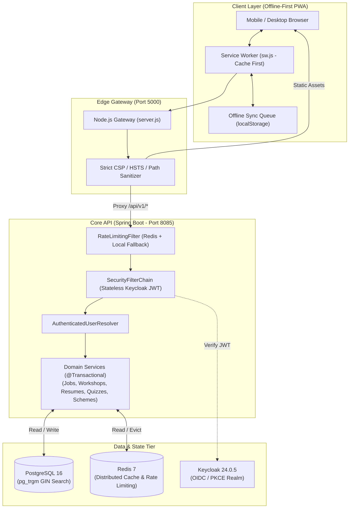

# 🌾 Gramin Career Setu — గ్రామీణ కెరీర్ సేతు
### *Rural Career Advancement & Employment Bridge Platform*

[](https://github.com/yogeshkamisetty/Gramin_Career_Setu)
[](https://openjdk.org/projects/jdk/21/)
[](https://spring.io/projects/spring-boot)
[](https://www.keycloak.org/)
[](https://www.postgresql.org/)
[](https://redis.io/)
[](https://deepmind.google/)

---

## 📖 Overview

**Gramin Career Setu** is an offline-first, bilingual (Telugu & English) career empowerment platform engineered specifically for rural youth in India who face severe information divides, language barriers, and intermittent internet connectivity. The platform bridges the gap between rural talent and economic opportunities by unifying localized job matching, government welfare schemes, scholarship discovery, skill workshops, and an automated ATS resume builder into a single accessible portal.

---

## 🛠️ Tech Stack

| Layer | Technologies & Frameworks | Purpose |
| :--- | :--- | :--- |
| **Frontend & PWA** | Semantic HTML5, CSS3 (Design Tokens, Responsive Grid), Vanilla ES6+ JavaScript | High-speed, zero-dependency client that runs smoothly on low-spec mobile devices. |
| **Bilingual & Voice** | Custom `i18n.js` Translation Engine, Web Speech API | Seamless English ↔ Telugu real-time toggling with voice narration for low-literacy accessibility. |
| **Edge Gateway** | Node.js native HTTP server (`server.js`) | Path-traversal sanitization, reverse-proxying API routes, and strict security headers (CSP, HSTS). |
| **Backend REST API** | Java 21, Spring Boot 3.3.5 (Spring MVC, Data JPA, Security, Actuator, Cache) | Modular monolith architecture organizing domain logic into distinct, transactional boundaries. |
| **Identity & Access** | Keycloak 24.0.5 (OAuth2 / OIDC Resource Server with JWT & PKCE flow) | Secure, standards-compliant authentication supporting Student, Volunteer, and District Admin roles. |
| **Persistence & Cache** | PostgreSQL 16 Alpine, Redis 7 Alpine, Flyway Migration Engine (`V1`–`V5`) | ACID-compliant relational data storage, trigram full-text indexing, query caching, and distributed rate limiting. |
| **DevOps & Containers** | Docker Compose v3.8, Shell/PowerShell DB backup/restore scripts | Containerized orchestration of the database, cache, auth server, and backend services. |

---

## 🏛️ Architecture & Data Flow



---

## 🤖 How Google Antigravity Was Used

Google Antigravity served as an autonomous, end-to-end software engineering partner across the entire development lifecycle:

* **From Static Mockups to Dynamic Full-Stack**:
  * Transformed a collection of disconnected static HTML prototypes into an integrated, interactive platform spanning 21 connected pages.
  * Designed and built the entire Java 21 / Spring Boot backend, configuring Spring Security with Keycloak OAuth2/OIDC, Flyway schema migrations, and JPA repositories from scratch.
* **Bilingual Translation Engineering**:
  * Unified a 168-key Telugu ↔ English dictionary embedded directly in `assets/i18n.js`, eliminating key mismatches and ensuring zero untranslated English leaks across all headings, navigation bars, and modals.
* **Vector Illustration Generation**:
  * Generated 4 custom high-resolution SVG artworks tailored to rural Indian culture: a village sunrise landscape, a celebratory student group, a smartphone OTP verification graphic, and a student working on a laptop against rural hills.
* **Multi-Role Engineering Audit & Remediation**:
  * Conducted an exhaustive audit acting simultaneously as **Principal Architect, Backend Engineer, Security Engineer, QA, DevOps, and Product Reviewer**.
  * Identified 10 concrete vulnerabilities and bottlenecks (including BOLA in workshop cancellation, rate-limiter IP spoofing, full table scans on job search, and cleartext PII logging) and remediated every single issue with a strict **dual-audit verification** process.
* **Automated CI/CD & Deployment**:
  * Automated testing, regression verification, and Git deployment pipelines directly to GitHub.
* **Autonomy Level**: **~90% Agent-Driven**. Architecture design, Java backend development, Spring Security configuration, Flyway migrations, SVG generation, translation dictionary compilation, debugging, and automated testing were performed autonomously by Antigravity, guided by high-level user specifications and design screenshots (~10% manual user steering).

---

## ✨ Key Features

1. **Bilingual Telugu ↔ English Engine with Voice Narration**:
   Allows instant, flicker-free toggling between Telugu and English across all 21 pages. Integrated with the Web Speech API to provide voice narration for rural youth with varying reading proficiencies.
2. **Offline-First Progressive Web App (PWA)**:
   Designed specifically for low-bandwidth and intermittent 2G/3G networks. Caches critical career resources, application forms, and workshop details locally, queueing offline submissions until network availability returns.
3. **Role-Based Authentication & Personalized Dashboards**:
   Features a 4-step responsive authentication flow (Mobile + Password, 6-digit OTP verification, and password strength scoring). Supports three distinct roles (**Student / Job Seeker**, **Village Coordinator / Volunteer**, and **District Admin**) with tailored dashboards and route protection.
4. **Rural ATS Resume Builder**:
   A streamlined, mobile-friendly resume builder that scores resumes against Applicant Tracking System (ATS) standards, offering actionable suggestions to help rural candidates present their skills effectively to formal employers.
5. **Unified Opportunity & Scheme Bridge**:
   A centralized repository for discovering verified local private and government job openings, state/central scholarships (e.g., Jagananna Vidya Deevena, AICTE Pragati), and welfare schemes (e.g., PM MUDRA, PM Vishwakarma).

---

## 🛡️ Challenges & Solutions

| Technical Challenge | Root Cause | Solution Implemented |
| :--- | :--- | :--- |
| **Language Translation Drift** | Missing keys between DOM elements and external JSON caused English text to persist when switching to Telugu. | Consolidated all 168 translation keys into a standalone, offline-ready dictionary in `assets/i18n.js` with automated DOM observer synchronization. |
| **BOLA / IDOR in Workshop Cancellation** | Public cancellation endpoint required only a phone number, allowing bad actors to cancel other users' bookings. | Implemented ownership checks in `WorkshopService.java`: authenticated users can only cancel their own registrations, while guest registrations require a secret cancellation code. |
| **Rate Limiter IP Spoofing** | Throttling filter trusted `X-Forwarded-For` blindly, allowing attackers to bypass rate limits by sending arbitrary IPs. | Sanitized IP resolution in `RateLimitingFilter.java` to only trust forwarded headers from verified local loopback/proxy subnets. |
| **Job Search Performance Bottlenecks** | Leading-wildcard queries (`LIKE '%query%'`) triggered sequential table scans across unindexed columns. | Authored Flyway migration `V5` introducing PostgreSQL `pg_trgm` GIN search indexes across job titles, qualifications, and company names. |
| **Clustered Scalability Limitations** | In-memory `ConcurrentHashMap` rate limiting was bound to a single JVM and could not scale across container replicas. | Integrated `StringRedisTemplate` for distributed atomic counters with 60-second TTL, maintaining graceful in-memory fallback for local dev. |

---

## 📊 Results & Outcomes

* **21 Fully Synchronized Pages**: Every page in the portal seamlessly shares the same navigation, bilingual toggle, offline state, and authenticated user session.
* **100% Automated Test Pass Rate**:
  * **35/35** Spring Boot backend integration tests passing (covering concurrency, rate limiting, and RBAC).
  * **18/18** Node.js gateway and contract tests passing (covering security headers, path traversal defense, and API payloads).
* **Production-Grade Infrastructure**: Fully containerized stack orchestrated via Docker Compose (PostgreSQL 16, Redis 7, Keycloak 24, Spring Boot 3.3.5, and Node.js Gateway).

---

## 📁 Repository Structure

```text
Gramin_Career_Setu/
├── README.md                      # Primary project overview and documentation
└── gramin-career-setu/            # Core application codebase
    ├── index.html                 # Main landing page
    ├── login.html                 # 4-Step role-based authentication portal
    ├── dashboard.html             # Authenticated student dashboard
    ├── careers.html               # Career pathways catalog
    ├── jobs.html                  # Job search & filtering engine
    ├── resume.html                # ATS resume builder & evaluator
    ├── quiz.html                  # RIASEC aptitude assessment quiz
    ├── scholarships.html          # State & central scholarship directory
    ├── schemes.html               # Government welfare schemes portal
    ├── workshops.html             # Live skill development workshops
    ├── server.js                  # Edge Node.js gateway & reverse proxy
    ├── docker-compose.yml         # Container orchestration (Postgres, Redis, Keycloak, Backend)
    │
    ├── assets/                    # Core frontend scripts, styles, and vector artwork
    │   ├── api.js                 # Unified REST client with offline sync engine
    │   ├── auth.js                # Role-based auth engine with OIDC / PKCE support
    │   ├── i18n.js                # Standalone bilingual translation dictionary
    │   └── ...                    # Custom SVG illustrations and stylesheets
    │
    ├── backend/                   # Spring Boot 3.3.5 / Java 21 Modular Monolith
    │   ├── pom.xml                # Maven project definition & dependencies
    │   ├── src/main/java/         # Domain packages (jobs, workshops, resumes, quiz, etc.)
    │   └── src/main/resources/    # Configs and Flyway database migrations (V1–V5)
    │
    └── tests/                     # Automated test suites
        └── project.test.js        # Node.js gateway and contract tests
```

---

## 🚀 Getting Started

### Prerequisites
- **Node.js**: v18 or newer
- **Docker & Docker Compose**: v2.20 or newer (for full backend stack)
- **Java**: 21 (optional, if running backend outside Docker)

### Quick Start (Local Web Server)
```bash
cd gramin-career-setu
node server.js
```
Open **[http://localhost:5000](http://localhost:5000)** in your browser.

### Full Stack Startup (Docker Compose)
```bash
cd gramin-career-setu
docker compose up -d
```
This launches:
- **PostgreSQL 16**: `localhost:5432`
- **Redis 7**: `localhost:6379`
- **Keycloak 24**: `localhost:8081`
- **Spring Boot Backend**: `localhost:8085`

### Running Automated Tests
```bash
cd gramin-career-setu
node --test tests/project.test.js
```

---

## 🔮 Future Scope

1. **WhatsApp & SMS Bot Integration**: Connect the backend to WhatsApp Business API / Twilio to deliver job alerts, scholarship deadlines, and workshop confirmations directly via chat.
2. **Offline-Mesh Peer-to-Peer Sync**: Enable Village Coordinators to collect applications in disconnected villages and sync them directly to a local coordinator's device via WebRTC or Bluetooth.
3. **AI-Powered Telugu Career Counselor**: Integrate a localized Gemini-powered voice assistant to conduct conversational aptitude discovery and guide first-generation learners toward suitable vocational paths.
