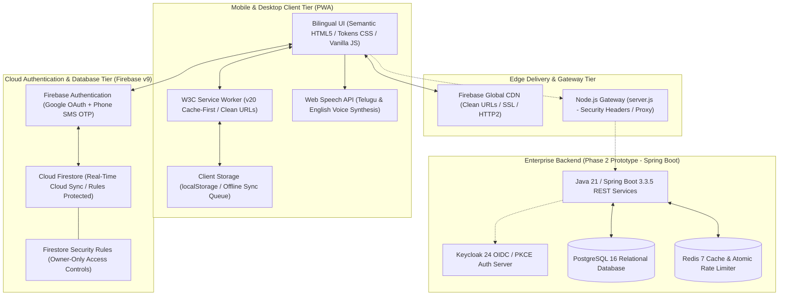

# 🌾 Gramin Career Setu — గ్రామీణ కెరీర్ సేతు
### *Next-Generation Rural Career Advancement, Education Roadmaps & Employment Platform*

[](https://gramin-career-setu.web.app)
[](https://github.com/yogeshkamisetty/Gramin_Career_Setu)
[](https://gramin-career-setu.web.app)
[](https://gramin-career-setu.web.app)
[](LICENSE)

---

## 🌟 Live Deployment

- **Official Web Portal**: [https://gramin-career-setu.web.app](https://gramin-career-setu.web.app)
- **Vercel Mirror**: [https://gramin-career-setu.vercel.app](https://gramin-career-setu.vercel.app)
- **Source Code**: [https://github.com/yogeshkamisetty/Gramin_Career_Setu](https://github.com/yogeshkamisetty/Gramin_Career_Setu)

---

## 📖 Executive Summary

**Gramin Career Setu** is an offline-first, bilingual (Telugu & English) progressive web platform designed specifically for rural youth across Andhra Pradesh and India who experience acute information gaps, language barriers, and intermittent internet connectivity.

While metropolitan students benefit from continuous career counseling, structured college admissions assistance, and direct industry pipelines, first-generation rural students often struggle to identify which examinations to take, when notifications are released, which welfare schemes fund their education, or how to compile a professional resume.

**Gramin Career Setu bridges this divide** through an empathetic, zero-friction web experience that operates reliably even on 2G/3G networks, provides verified step-by-step career roadmaps, signs posts to authentic official portals, and equips rural youth with practical tools for upward economic mobility.

---

## 🏛️ System Architecture



---

## ✨ Key Capabilities & Features

### 1. 🗺️ Career Roadmap Generator (8 Verified Pathways)
- **Education-Aware Starting Point**: Students select their current stage (`Below 10th`, `10th Pass`, `Intermediate (10+2)`, `ITI / Diploma`, or `Degree`). The system starts the progression where they *actually* stand instead of assuming a college degree.
- **Dedicated Engineering Pathways**:
  - **Software & Technology Engineer**: Guidance on Intermediate MPC, AP EAPCET / ECET, free certified IT tracks (SWAYAM, APSSDC), coding projects on GitHub, and graduate hiring drives (TCS NQT).
  - **Core Engineering (Civil, Mechanical & Electrical)**: Step-by-step progression through Polytechnic Diploma (AP POLYCET), lateral entry B.Tech, APPSC Assistant Executive Engineer (AEE), and Village Secretariat engineering posts.
- **Other Core Paths**: Police Constable & Sub-Inspector, School Teacher & College Lecturer, Healthcare & Nursing, State Govt Clerical (Group 4), ITI Skilled Trades, and Rural Entrepreneurship.
- **Zero Volatile Claims**: Encodes long-standing educational milestones while signposting directly to official portals (`apsche.ap.gov.in`, `slprb.ap.gov.in`, `psc.ap.gov.in`) rather than hardcoding fragile vacancy numbers or age limits.

### 2. 📱 Mobile-First Responsive Interface
- **Universal 5-Tab Mobile Dock**: Fixed bottom floating navigation dock with instant access to **Home**, **Careers**, **Jobs**, **Roadmap**, and **Profile / Dashboard**.
- **Adaptive Header User Pill**: Compact avatar pill on smartphones that expands into a rich user card with quick shortcuts to **My Dashboard**, **My Profile**, and **Sign Out**.
- **Slide-Up Bottom Sheet Menu**: Provides rapid access to government schemes, scholarships, workshops, and language switcher.
- **Interactive Font-Size Scaler**: Accessible floating text scaler offering 4 presets (`Small`, `Normal`, `Large`, `Extra Large`) multiplying design tokens site-wide for older screens or visually impaired users.

### 3. 🔍 Career & Job Opportunities Engine
- **Multi-Category Filtering**: Instant live filtering for Technology/Engineering, Teaching, Police & Defense, Healthcare, Banking, Agriculture, and Business.
- **Synonym & Multi-Tag Matching**: Selecting "Engineering" intelligently presents both Software Engineering and Core Civil/Polytechnic roles.
- **Live Counter & Empty-State Assistance**: Real-time feedback badge showing the count of matching careers with 1-click filter reset.
- **Direct Roadmap Jumps**: Every career card features both a **View Details** action and a direct **Roadmap** button linking to the step-by-step progression generator.

### 4. 🔐 Dual-Authentication & Cloud Synchronization
- **Google OAuth Sign-In**: 1-click single sign-on authenticated via Google Firebase Auth.
- **Real Cellular Phone OTP**: Live SMS verification code delivery via Google Firebase Identity Platform.
- **Classroom / Evaluator Demo Modes**: Built-in 1-click demo logins for **Student**, **Volunteer**, and **District Admin** roles for quick evaluation without credentials.
- **Cloud Firestore Real-Time Persistence**: User profiles, generated resumes, and quiz attempt scores automatically synchronize across user devices while backed up offline in `localStorage`.
- **Owner-Only Security Rules**: Firestore read/write permissions strictly enforce authentication and owner-matching user ID security checks.

### 5. 📄 ATS-Optimized Rural Resume Builder
- **Zero-Dependency Browser Engine**: Clean, printable one-page resume generator formatted according to modern Applicant Tracking System (ATS) guidelines.
- **Objective & Skill Guardrails**: Enforces concise length standards and provides verified career examples.
- **Instant PDF & Print Export**: Uses browser print rendering engine to ensure clean formatting and native support for Telugu character sets.

### 6. 🌐 Progressive Web App (PWA) & Offline Shell
- **Service Worker v20**: Precaches essential assets (~1.2 MB app shell) and caches secondary routes during navigation.
- **Clean URLs Enforcement**: Strips `.html` extensions across all navigation routes (`/careers`, `/jobs`, `/dashboard`, `/profile`, `/roadmap`, `/resume`, `/quiz`) with zero 301 redirect loops.
- **PWA Install Banners**: Full `manifest.json` configuration with high-resolution adaptive, maskable, and Apple touch icons for Android & iOS home screen installation.

### 7. 🗣️ Bilingual i18n Engine & Voice Assistance
- **Flicker-Free Translation**: Complete English ↔ Telugu dictionary (`assets/i18n.js`) with DOM observer support.
- **Web Speech Narration**: Reads out career titles, requirements, and search assistance for students with limited textual literacy.

---

## 🎯 The 4A Community Framework

Gramin Career Setu is structured around the **4A Framework** for grassroots community impact:

| Pillar | Principle | How the Platform Delivers |
| :--- | :--- | :--- |
| **Awareness** | Dispel rural information blackouts | Curated career paths, entrance test calendars, and educational fee reimbursement schemes (RTF/MTF). |
| **Access** | Eliminate technological & literacy barriers | Offline PWA, low-bandwidth footprint, bilingual Telugu/English toggle, and voice narration. |
| **Action** | Transform information into tangible progress | Printable ATS resumes, step-by-step career roadmaps, and direct portal application guides. |
| **Accountability** | Maintain student trust through authentic data | Grounded role signposts without fabricated vacancies; open-source and transparent. |

---

## 🛠️ Complete Tech Stack

| Tier | Technologies | Role & Purpose |
| :--- | :--- | :--- |
| **Frontend Core** | Semantic HTML5, CSS3, Vanilla ES6+ JavaScript | Zero-framework, ultra-fast client executing without heavy node bundlers. |
| **Styling & Tokens** | Design Tokens (`tokens.css`), Responsive Grid (`ui.css`) | Uniform typography, spacing, and responsive breakpoints across all 21 pages. |
| **Client Authentication** | Firebase Auth v9 Modular SDK (CDN) | Google Identity Services, Phone SMS verification, and demo session management. |
| **Cloud Database** | Google Cloud Firestore (v9 Modular) | Real-time cloud synchronization for user documents, resumes, and quiz results. |
| **PWA & Offline** | Service Worker API (`sw.js`), Cache API, Web Manifest | Offline app shell precaching, dynamic runtime caching, and install banners. |
| **Edge Server** | Node.js native HTTP server (`server.js`) | Path-traversal sanitization, clean URL routing, security headers (CSP, HSTS). |
| **Phase 2 Backend** | Java 21, Spring Boot 3.3.5 (MVC, Data JPA, Security) | Scalable modular monolith backend prepared for institutional state deployment. |
| **Identity Server** | Keycloak 24.0.5 (OAuth2 / OIDC, PKCE Flow) | Standards-compliant enterprise authentication supporting RBAC roles. |
| **Persistence & Cache** | PostgreSQL 16 Alpine, Redis 7 Alpine, Flyway | Relational data persistence, pg_trgm search indexes, and atomic rate limiters. |
| **Testing & QA** | Node.js native test runner (`node --test`) | 55 automated integration, contract, security, and content integrity tests. |

---

## 📁 Repository Structure

```text
Gramin_Career_Setu/
├── .firebaserc                     # Firebase active project configuration
├── firebase.json                   # Firebase Hosting & Firestore rules configuration
├── firestore.rules                 # Cloud Firestore owner-only security rules
├── vercel.json                     # Vercel mirror routing & clean URL rewrites
├── manifest.json                   # Web App Manifest for mobile installation
├── sw.js                           # Root service worker loader
├── server.js                       # Local & edge Node.js HTTP server
├── package.json                    # Project metadata & test scripts
│
├── assets/                         # Client scripts, stylesheets, and icons
│   ├── firebase-config.js          # Unified Firebase Auth & Firestore client
│   ├── auth.js                     # Header auth sync, profile menus, and auth flows
│   ├── app.js                      # MobileUiController, bottom nav dock, font scaler
│   ├── api.js                      # REST client with offline sync fallback
│   ├── i18n.js                     # Bilingual Telugu ↔ English dictionary
│   ├── actions.js                  # Shared event bus and UI interactions
│   ├── resume-builder-engine.js    # ATS resume evaluator and formatting engine
│   ├── sw.js                       # Service Worker v20 implementation
│   ├── ui.css                      # Global responsive components and layouts
│   ├── tokens.css                  # CSS custom properties and scaling variables
│   ├── icon-192.png                # PWA launcher icon (192x192)
│   ├── icon-512.png                # PWA launcher icon (512x512)
│   └── icon-maskable.png           # PWA adaptive maskable icon
│
├── data/                           # Canonical datasets rendered across the platform
│   ├── roadmaps.js                 # Career roadmaps data with bilingual steps
│   ├── jobs.csv                    # Grounded rural job roles dataset
│   ├── jobs-data.js                # Compiled browser-ready jobs database
│   ├── workshops.js                # Rural workshop curriculum and schedules
│   └── survey-data.js              # Before/after student impact survey template
│
├── tests/                          # Automated quality assurance suites
│   ├── project.test.js             # Core tests: security, clean URLs, roadmaps, i18n
│   └── mobile-firebase.test.js     # Firebase auth, font scaler, and mobile tests
│
├── backend/                        # Phase 2 Spring Boot 3.3.5 / Java 21 Monolith
│   ├── pom.xml                     # Maven build descriptor
│   └── src/main/java/              # Domain modules (Jobs, Resumes, Quizzes, Workshops)
│
├── docs/                           # Project architecture and technical guides
│   ├── FIREBASE_BACKEND_PLAN.md    # Cloud Firestore database schema & auth plan
│   └── PPT_Script_and_Viva_Guide.md# Viva preparation and presentation script
│
├── index.html                      # Landing page with Crossroads interactive hero
├── careers.html                    # Career categories catalog & roadmap linkers
├── career-detail.html              # In-depth career profiles with salary & syllabus
├── jobs.html                       # Qualification-filtered job opportunities
├── dashboard.html                  # Authenticated student dashboard with stats
├── profile.html                    # User profile and account preferences
├── roadmap.html                    # Dynamic Career Roadmap Generator
├── resume.html                     # Interactive ATS resume builder
├── resume-preview.html             # Print and PDF resume view
├── quiz.html                       # 5-question career aptitude quiz
├── quiz-results.html               # Personalized aptitude recommendations
├── scholarships.html               # State & central scholarship directory
├── schemes.html                    # Government welfare schemes catalog
├── workshops.html                  # Physical village workshop schedules
├── resources.html                  # Curated study resources and digital tools
├── stories.html                    # Student transformation stories & ethical checklist
├── apply-online.html               # Step-by-step visual online application guide
├── about.html                      # Project genesis, team, and 4A framework
└── 404.html                        # Branded, helpful 404 fallback page
```

---

## 🚀 Getting Started & Local Development

### Prerequisites
- **Node.js**: v18.0.0 or higher
- **Modern Browser**: Chrome, Edge, Firefox, or Safari

### 1. Clone the Repository
```bash
git clone https://github.com/yogeshkamisetty/Gramin_Career_Setu.git
cd Gramin_Career_Setu
```

### 2. Start the Local Server
```bash
npm start
# or: node server.js
```
Open **[http://localhost:5000](http://localhost:5000)** in your browser.

### 3. Run the Automated Test Suite
```bash
npm test
```
*Executes all 55 integration and contract tests across both test suites.*

---

## ☁️ Deployment & Cloud Hosting

### Deploying to Firebase Hosting & Cloud Firestore
The project is configured for one-command deployment to Firebase Hosting and Cloud Firestore:
```bash
# 1. Login to Firebase CLI
npx firebase login

# 2. Deploy hosting and Firestore security rules
npx firebase deploy --only hosting,firestore:rules
```

### Deploying to Vercel
```bash
npx vercel --prod
```

---

## 🧪 Testing & Verification Overview

Our automated test suite (`tests/project.test.js` and `tests/mobile-firebase.test.js`) validates:

1. **Path-Traversal & Web Security**: Verifies path-sanitization on `server.js`, strict HTTP security headers (CSP, HSTS, X-Content-Type-Options), and traversal blocking.
2. **PWA & Font-Scaling System**: Tests dynamic HTML scaling via `--mobile-font-scale` across `small`, `normal`, `large`, and `xlarge` presets.
3. **Firebase & Auth Integrity**: Asserts owner-only Firestore security rules, OIDC/PKCE handling, and demo session isolation.
4. **Career Roadmap Accuracy**: Validates that all roadmap steps answer the 6 core questions in both Telugu and English, contain zero volatile/stale figures, and remain reachable from 10th class.
5. **Content & Anti-Fabrication Safeguards**: Guarantees that no fabricated job listings, fake testimonials, or unsubstantiated match percentages are shipped.

---

## 👥 Credits & Project Context

Developed as a dedicated **Community Service Project (CSP)** by **Yogesh Kamisetty** and team.

Special thanks to the rural youth, village coordinators, and educators whose honest feedback shaped the simplicity, language clarity, and offline-first architecture of Gramin Career Setu.

---

## 📄 License

Distributed under the **MIT License**. See `LICENSE` for details.
