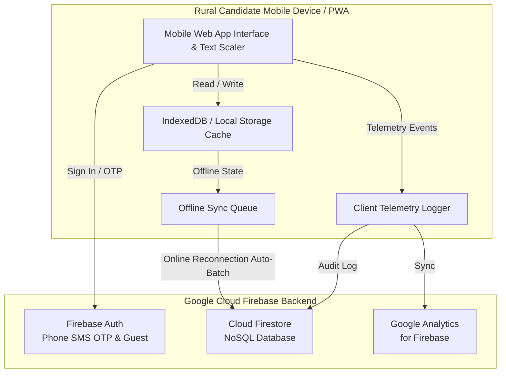

# Gramin Career Setu — Firebase Backend & Architecture Plan
**గ్రామీణ కెరీర్ సేతు — ఫైర్‌బేస్ బ్యాకెండ్ మరియు డేటా ఆర్కిటెక్చర్ ప్రణాళిక**

---

## 1. Executive Evaluation: Firebase vs. Supabase for Rural PWA

| Evaluation Metric | Google Firebase (Recommended) | Supabase |
| :--- | :--- | :--- |
| **Offline-First Resilience** | **Native out-of-the-box** via Firestore IndexedDB persistence (`enablePersistence`). Offline writes queue automatically and sync when online. | Requires third-party complex offline engines (e.g. RxDB, WatermelonDB) to cache PostgreSQL data locally. |
| **Rural Authentication** | **Native Phone SMS OTP** without additional billing. Perfect for rural youth who possess a mobile number but no personal email. | Requires external paid SMS gateways (Twilio, MessageBird) with per-SMS API cost. |
| **Client-Side Telemetry & Logs** | **Zero server maintenance**: Built-in Google Analytics & Firestore client logging from static GitHub Pages. | Requires spinning up separate logging pipelines or writing custom API endpoints. |
| **Hosting & Operating Cost** | **100% Free** on Spark Plan (50k reads/day, 20k writes/day, 10k phone auths/month). | Free tier pauses after inactivity; paid add-ons required for SMS gateways. |
| **PWA / Static Web App Fit** | Client-centric SDK with modular imports; zero backend server provisioning required. | Postgres-centric; best suited for traditional relational enterprise backends. |

### Conclusion & Recommendation
For **Gramin Career Setu**, **Firebase is the definitive and optimal choice**. It guarantees that rural candidates on slow 2G/3G connections or intermittent electricity can build resumes, complete career quizzes, bookmark opportunities, and submit workshop registrations completely offline, with automatic zero-loss synchronization when the connection restores.

---

## 2. Architecture & Data Transfer Flow



---

## 3. Cloud Firestore Data Schema Specification

### 3.1. Collection: `users`
Represents candidate profiles, demographic details, and accessibility preferences.

```json
{
  "_id": "usr_9848022338",
  "phone": "+919848022338",
  "name": "Kamisetty Yogesh",
  "village": "Bahubalendrunigudem",
  "mandal": "Gannavaram",
  "district": "Krishna",
  "state": "Andhra Pradesh",
  "qualification": "10th",
  "preferredLanguage": "te",
  "fontScale": "large",
  "createdAt": "2026-11-10T14:30:00Z",
  "lastActiveAt": "2026-11-10T14:30:00Z"
}
```

### 3.2. Collection: `quiz_attempts`
Captures student aptitude responses, calculated scores, and recommended career tracks.

```json
{
  "_id": "qa_8f93e2b1",
  "userId": "usr_9848022338",
  "timestamp": "2026-11-10T14:35:00Z",
  "lang": "te",
  "score": 85,
  "cluster": "Technical & Digital Services",
  "recommendedRoles": [
    "Solar Technician",
    "Data Entry Operator",
    "Electrician"
  ],
  "answers": [
    { "qId": 1, "answer": "Practical hands-on machinery" },
    { "qId": 2, "answer": "Computer and typing" }
  ],
  "syncedOffline": true
}
```

### 3.3. Collection: `resumes`
Stores candidate resumes built via the interactive Resume Builder, supporting bilingual export.

```json
{
  "_id": "res_usr_9848022338",
  "userId": "usr_9848022338",
  "updatedAt": "2026-11-10T14:40:00Z",
  "template": "classic",
  "language": "te",
  "personal": {
    "fullName": "Kamisetty Yogesh",
    "phone": "9848022338",
    "email": "yogesh@example.com",
    "village": "Bahubalendrunigudem"
  },
  "education": [
    {
      "institution": "Z.P. High School",
      "degree": "SSC (10th Standard)",
      "year": "2023",
      "grade": "8.8 CGPA"
    }
  ],
  "skills": ["Computer Basics", "MS Office", "Telugu Typing", "Solar Installation"]
}
```

### 3.4. Collection: `telemetry_logs`
Tracks app interactions, language swaps, font scale adjustments, and offline activity for project impact auditing.

```json
{
  "_id": "log_7721a9",
  "action": "font_scale_changed",
  "userId": "usr_9848022338",
  "timestamp": "2026-11-10T14:42:00Z",
  "path": "/jobs.html",
  "meta": {
    "fromScale": "normal",
    "toScale": "large",
    "deviceWidth": 390
  }
}
```

---

## 4. Firestore Security Rules (`firestore.rules`)

```javascript
rules_version = '2';
service cloud.firestore {
  match /databases/{database}/documents {
    
    // User profile: only authenticated owner can read or write
    match /users/{userId} {
      allow read, write: if request.auth != null && request.auth.uid == userId;
    }
    
    // Resumes: only the owner can modify
    match /resumes/{userId} {
      allow read, write: if request.auth != null && request.auth.uid == userId;
    }
    
    // Quiz attempts: authenticated user or guest can create
    match /quiz_attempts/{attemptId} {
      allow create: if true;
      allow read: if request.auth != null && request.auth.uid == resource.data.userId;
    }
    
    // Telemetry logs: append-only for auditing
    match /telemetry_logs/{logId} {
      allow create: if true;
      allow read: if false; // Admin-only via Firebase Console
    }
  }
}
```

---

## 5. Setup & Connection Instructions

### Step 1: Create Firebase Project
1. Navigate to the [Firebase Console](https://console.firebase.google.com/).
2. Click **Add Project** and name it `gramin-career-setu`.
3. Enable Google Analytics (free) for usage tracking.

### Step 2: Enable Authentication Providers
1. Under **Build > Authentication**, click **Get Started**.
2. Enable **Phone**:
   - Under *Phone numbers for testing*, add your test mobile number: `+91 98480 22338` with verification code `123456`.
3. Enable **Anonymous** for instant guest sign-ins without barrier to entry.

### Step 3: Initialize Cloud Firestore
1. Under **Build > Firestore Database**, click **Create Database**.
2. Select Location: `asia-south1` (Mumbai) for minimum network latency in Andhra Pradesh.
3. Start in **Production Mode** and paste the Security Rules provided in Section 4 above.

### Step 4: Link Firebase to Gramin Career Setu
Open [`assets/firebase-config.js`](file:///D:/Yogesh/Coding/CSP/assets/firebase-config.js) and replace the configuration block with your credentials from Project Settings:

```javascript
const FIREBASE_CONFIG = window.GCS_FIREBASE_CONFIG || {
  apiKey: "YOUR_ACTUAL_FIREBASE_API_KEY",
  authDomain: "gramin-career-setu.firebaseapp.com",
  projectId: "gramin-career-setu",
  storageBucket: "gramin-career-setu.appspot.com",
  messagingSenderId: "YOUR_SENDER_ID",
  appId: "YOUR_APP_ID",
  measurementId: "G-YOUR_MEASUREMENT_ID"
};
```

---
*Prepared for Gramin Career Setu — Community Service Project (CSP).*
